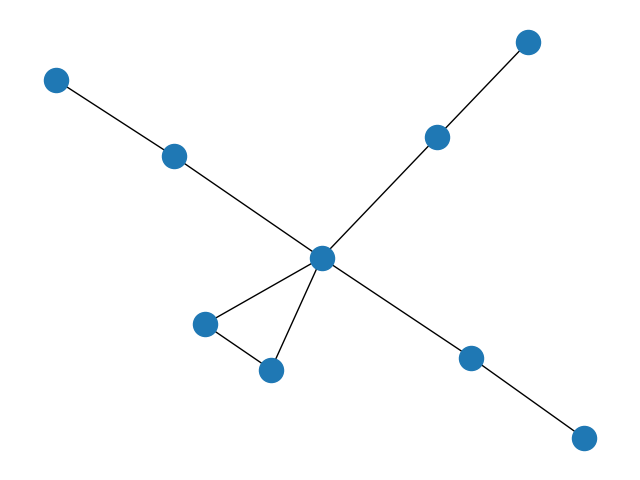
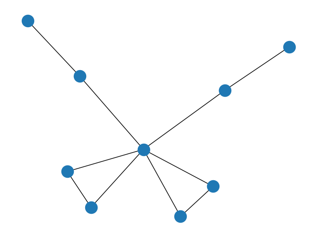
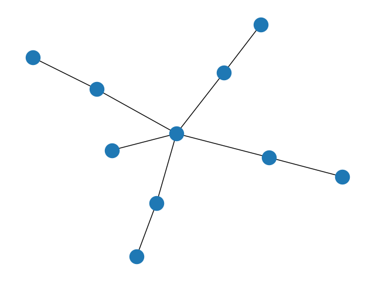
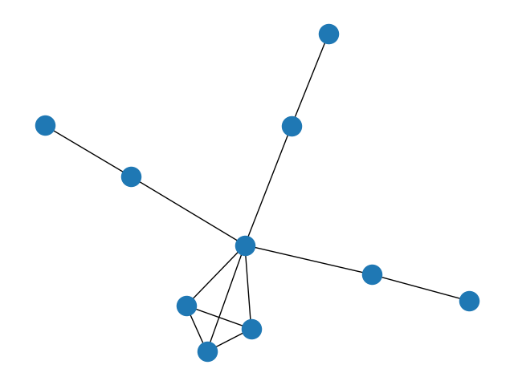
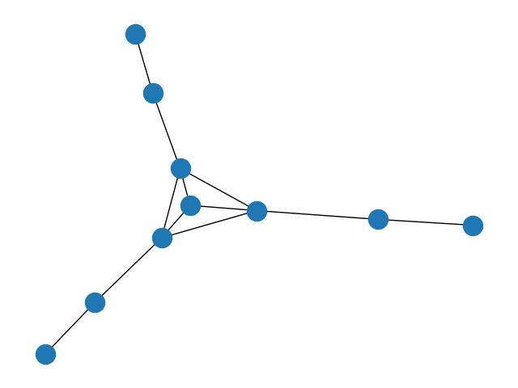

# 9 vertices

000000100001000001000000100011111000
```
0 0 0 0 1 0 0 0 1
0 0 0 0 0 1 0 0 1
0 0 0 0 0 0 1 0 1
0 0 0 0 0 0 0 1 1
1 0 0 0 0 0 0 0 1
0 1 0 0 0 0 0 0 0
0 0 1 0 0 0 0 0 0
0 0 0 1 0 0 0 0 0
1 1 1 1 1 0 0 0 0
```


000000100001000001000000100011111100
```
0 0 0 0 1 0 0 0 1
0 0 0 0 0 1 0 0 1
0 0 0 0 0 0 1 0 1
0 0 0 0 0 0 0 1 1
1 0 0 0 0 0 0 0 1
0 1 0 0 0 0 0 0 1
0 0 1 0 0 0 0 0 0
0 0 0 1 0 0 0 0 0
1 1 1 1 1 1 0 0 0
```


# 10 vertices

000000000010000010000001000000010000111110000
```
0 0 0 0 0 1 0 0 0 1
0 0 0 0 0 0 1 0 0 1
0 0 0 0 0 0 0 1 0 1
0 0 0 0 0 0 0 0 1 1
0 0 0 0 0 0 0 0 0 1
1 0 0 0 0 0 0 0 0 0
0 1 0 0 0 0 0 0 0 0
0 0 1 0 0 0 0 0 0 0
0 0 0 1 0 0 0 0 0 0
1 1 1 1 1 0 0 0 0 0
```


000000100001000001000000100010001000111110001
```
0 0 0 0 1 0 0 0 1 1
0 0 0 0 0 1 0 0 0 1
0 0 0 0 0 0 1 0 0 1
0 0 0 0 0 0 0 1 0 1
1 0 0 0 0 0 0 0 1 1
0 1 0 0 0 0 0 0 0 0
0 0 1 0 0 0 0 0 0 0
0 0 0 1 0 0 0 0 0 0
1 0 0 0 1 0 0 0 0 1
1 1 1 1 1 0 0 0 1 0
```


000000100001000001000100100011001000101010001
```
0 0 0 0 1 0 0 1 1 1
0 0 0 0 0 1 0 0 1 0
0 0 0 0 0 0 1 0 0 1
0 0 0 0 0 0 0 1 0 0
1 0 0 0 0 0 0 0 1 1
0 1 0 0 0 0 0 0 0 0
0 0 1 0 0 0 0 0 0 0
1 0 0 1 0 0 0 0 0 0
1 1 0 0 1 0 0 0 0 1
1 0 1 0 1 0 0 0 1 0
```

